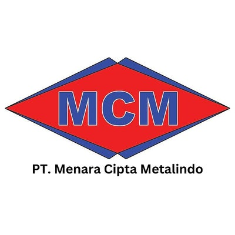
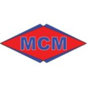

# Audit visual logo publik MCM

Tanggal: 17 November 2026. Fokus: redesign untuk seragam baru.

## Ringkasan keputusan
**Prioritaskan evolusi logo, bukan penggantian total.** Aset pengenal yang paling terlihat adalah huruf MCM, bidang belah ketupat melebar, dan pasangan merah–biru. Titik perbaikan utama: kompleksitas tepi, outline tipis huruf, dan keterbacaan nama lengkap pada aplikasi kecil.

Ini penilaian desain atas gambar publik, bukan hasil survei pengguna, validasi merek dagang, atau uji produksi. Status versi aktif belum dikonfirmasi pemilik perusahaan.

## 1. Bukti yang diperiksa

### Referensi utama: profil Linktree

Sumber halaman: https://linktr.ee/ptmcm (S8). Profil memakai nama PT. Menara Cipta Metalindo, deskripsi fabrikator sheet metal/komponen alat berat, dan menautkan situs menaracipta.com. Identitas halaman mendukung relevansi sumber, tetapi bukan bukti independen bahwa akun dikelola perusahaan atau logo ini versi terakhir.

### Referensi pendukung: direktori lowongan

Sumber halaman: https://depokloker.com/perusahaan/pt-menara-cipta-metalindo (S9). Gambar lebih kecil; memuat simbol tanpa baris nama lengkap yang terlihat pada referensi utama. Ini bisa berupa pemotongan/penyesuaian avatar, bukan otomatis varian resmi.

Kedua gambar diperoleh melalui pencarian gambar dan diperiksa visual. Berkas adalah salinan raster hasil pencarian, bukan master perusahaan. Tidak dipakai untuk mengukur warna resmi atau presisi geometri. Hak atas logo tetap pada pemiliknya; disimpan hanya sebagai referensi audit, bukan aset desain buatan repository ini.

Gambar profil dari situs perusahaan (`assets/mcm/page_01.png`) dicoba dibaca tetapi gagal melalui alat pengambilan halaman. Tidak digunakan sebagai bukti visual.

## 2. Inventaris visual — observasi, bukan filosofi

| Elemen | Yang terlihat |
|---|---|
| Siluet | Belah ketupat horizontal yang lebar, ujung kiri–kanan meruncing |
| Bidang utama | Merah solid |
| Elemen tepi | Bidang/pita biru pada sisi miring, garis gelap tipis, serta pertemuan bertakik/berpotongan di sekitar puncak atas dan bawah |
| Inisial | MCM kapital besar, biru, dengan outline terang tipis |
| Tipografi inisial | Sans-serif tebal; jenis font belum diidentifikasi |
| Nama lengkap | “PT. Menara Cipta Metalindo” hitam, sans-serif tebal di bawah simbol pada referensi utama |
| Latar referensi | Putih; belum terbukti bagian wajib identitas |

Tidak ada dasar untuk menyatakan merah berarti keberanian atau biru berarti kepercayaan sebagai filosofi resmi. Tidak ada kode HEX/Pantone yang ditetapkan dari JPEG ini.

## 3. Kekuatan yang layak dipertahankan
- **Hierarki awal jelas:** MCM adalah fokus pertama, nama lengkap sebagai identifikasi kedua.
- **Siluet mudah diringkas:** bidang melebar memberi bentuk dasar yang tetap dikenali tanpa detail internal.
- **Huruf cukup tebal:** titik awal yang baik untuk reproduksi tekstil, meski detail akhirnya tetap perlu diuji.
- **Sudah memakai warna datar:** tidak bergantung pada efek krom atau gradasi.
- **Ada kesinambungan antara dua referensi:** simbol MCM merah–biru sama-sama tampak, sehingga layak menjadi hipotesis aset pengenal. Belum membuktikan tingkat pengenalan oleh karyawan/pelanggan.

## 4. Masalah dan prioritas

| Prioritas | Temuan | Dampak potensial pada seragam | Usulan |
|---|---|---|---|
| Tinggi | Outline terang huruf sangat tipis dibanding massa huruf | Detail pembatas dapat hilang/berubah saat dijahit kecil; batas huruf biru terhadap merah perlu diuji | Uji tanpa outline, outline lebih tegas, dan versi huruf negatif; jangan hapus tanpa perbandingan |
| Tinggi | Nama lengkap jauh lebih kecil daripada inisial | Bisa tidak terbaca bila seluruh lockup diperkecil untuk dada | Besarkan proporsi nama; uji dua baris atau lockup horizontal; versi ringkas hanya dengan persetujuan |
| Tinggi | Tepi memuat pita biru, garis gelap, dan pertemuan runcing kecil | Menambah detail digitizing dan risiko pergeseran batas antarbidang | Sederhanakan jumlah lapisan/garis serta rapikan ujung dan sambungan |
| Sedang | Ujung kiri–kanan memakan ruang tanpa menambah luas huruf | Pada lebar dada terbatas, huruf mendapat area lebih kecil | Uji belah ketupat lebih kompak, sambil menjaga karakter melebar |
| Sedang | Merah dan biru bersebelahan pada banyak batas | Pemisahan visual bisa berubah menurut pilihan benang dan warna kain | Bandingkan sampel warna benang, versi satu warna, dan negatif |
| Sedang | Ada dua penyajian publik: simbol saja dan simbol + nama | Penggunaan seragam berpotensi tidak konsisten tanpa aturan | Tetapkan lockup utama dan varian kecil, ukuran minimum, serta ruang bebas setelah uji |

Risiko di atas adalah perkiraan profesional dari visual, **bukan bukti bahwa bordir lama bermasalah**. Ketajaman piksel JPEG tidak boleh dianggap cacat master logo.

## 5. Penerapan satu warna dan latar
- Jika semua bidang sekadar diubah menjadi warna sama, huruf dan latar bisa menyatu. Versi monokrom perlu dirancang secara sengaja, misalnya huruf knockout dan tepi disederhanakan.
- Outline terang mungkin membantu pemisahan MCM pada gambar berwarna; jangan menghilangkannya tanpa mengganti fungsi pemisahannya.
- Putih pada gambar belum terbukti kotak latar wajib. Jangan langsung membuat patch persegi putih berdasarkan avatar.
- Warna seragam belum diketahui; belum dapat memutuskan merah–biru akan cukup kontras pada kain final.

## 6. Arah redesign yang direkomendasikan

### A — evolusi konservatif (prioritas)
Pertahankan MCM + siluet belah ketupat + keluarga merah–biru sebagai kandidat aset warisan. Rapikan konstruksi tepi, konsistensi jarak huruf, serta hubungan simbol dan nama lengkap. Pilih warna resmi setelah memperoleh master/persetujuan perusahaan.

### B — penyederhanaan khusus tekstil
Turunkan A menjadi varian kecil: lebih sedikit detail tepi, huruf lebih dominan, dan versi satu warna. Harus terasa satu keluarga dengan logo utama, bukan logo perusahaan kedua.

### C — reinterpretasi MCM (opsional)
Eksplorasi huruf geometris dengan inspirasi bidang/lipatan logam hanya jika perusahaan memperbolehkan perubahan lebih jauh. Nilai berdampingan dengan A, bukan langsung menggantikannya.

**Hindari:** mengganti ke simbol menara/roda gigi generik, menghapus seluruh aset pengenal tanpa alasan, menambah slogan/sertifikasi rekaan, atau sekadar men-trace JPEG lalu menyebutnya redesign.

## 7. Rencana validasi sebelum dipilih
1. Konfirmasi bahwa referensi ini benar logo aktif; minta master vektor dan foto seragam lama.
2. Pastikan elemen wajib, warna/bahan seragam baru, lokasi, ukuran maksimal, serta teknik produksi.
3. Bandingkan lama vs A vs B pada lebar percobaan 70/85/100 mm. Angka ini usulan pengujian, bukan spesifikasi panitia.
4. Periksa warna, satu warna, negatif, serta keterbacaan nama lengkap pada ukuran aktual. Jangan menyamakan tinggi font digital dengan tinggi huruf fisik.
5. Jika bordir, minta vendor meninjau outline, sambungan runcing, ruang negatif, dan area isi merah; kepadatan jahitan/kekakuan tidak bisa ditentukan dari gambar saja.
6. Setujui sampel fisik pada kain final, termasuk setelah perawatan sesuai petunjuk material.

## Batas kesimpulan
Belum dilakukan pengujian fisik, pengukuran kontras warna resmi, identifikasi font, analisis master vektor, pencarian kemiripan merek, atau pengukuran pengenalan merek. Tidak diberikan skor numerik agar tidak menimbulkan kesan pengujian objektif yang belum dilakukan.

Sumber dan konteks teknis: [register sumber](sumber.md), [aplikasi seragam](aplikasi-seragam.md).
