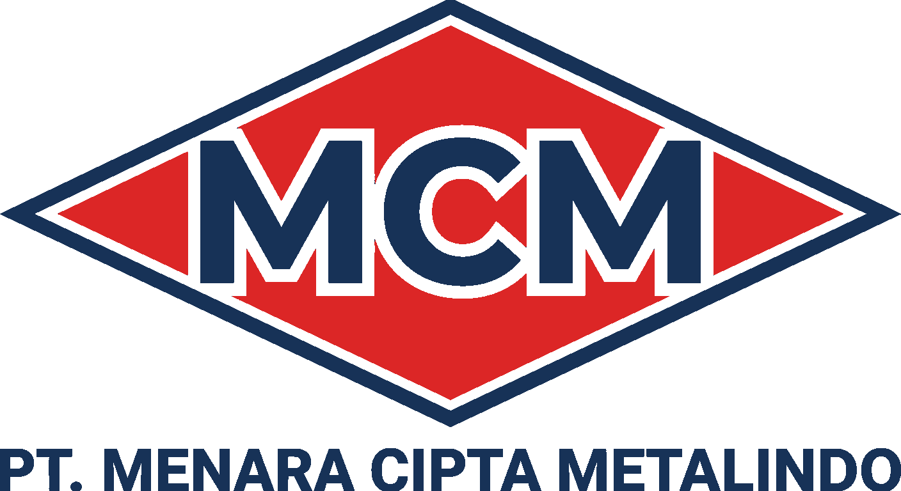
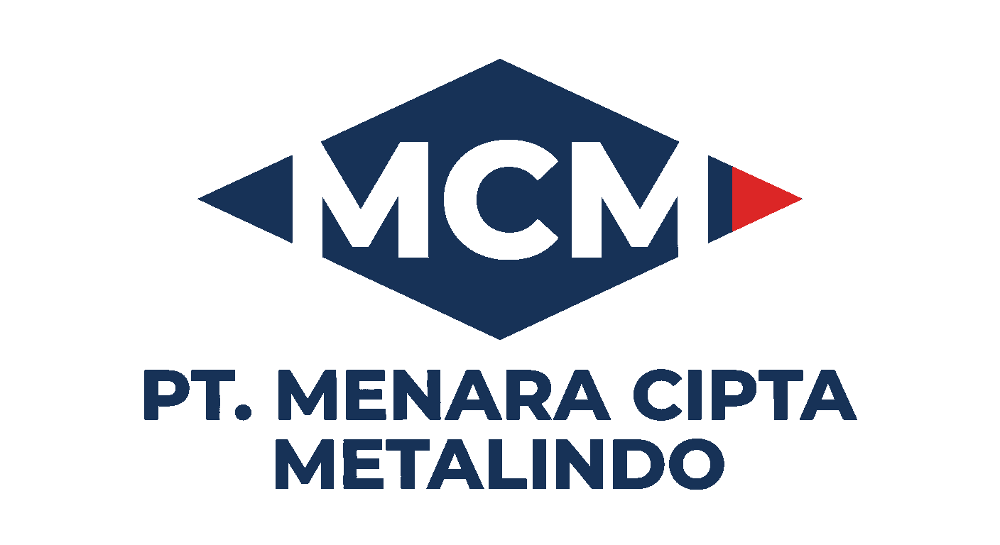
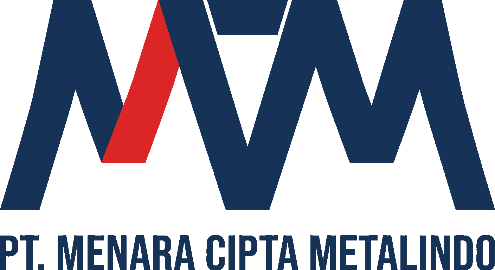
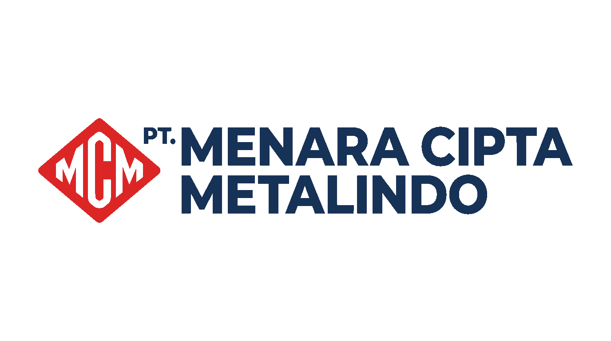
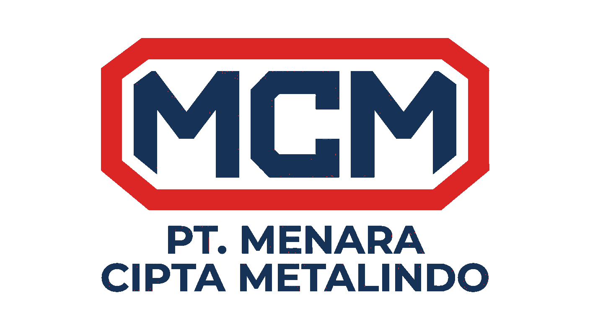

# Lima variasi logo MCM

Konsep visual hasil generasi AI. Belum master vektor, belum diuji bordir, belum diperiksa kemiripan merek. Pemakaian AI masih perlu disesuaikan dengan ketentuan sayembara. Warna dan bentuk belum disetujui perusahaan.

## 01 — Evolusi logo lama

Mempertahankan belah ketupat merah dan MCM biru; arah perubahan paling konservatif.

## 02 — Diamond negatif

MCM putih pada bidang biru, dengan aksen merah; eksplorasi pemisahan huruf dan latar.

## 03 — Lipatan metal

Eksplorasi MCM geometris terinspirasi bidang logam; perubahan lebih jauh dari logo lama.

## 04 — Komposisi horizontal

Simbol di kiri dan nama di kanan; alternatif susunan untuk area yang memanjang.

## 05 — Bingkai industrial

Bingkai merah dan MCM biru tua, menggunakan palet yang sama dengan konsep lainnya.

## Revisi palet solid

Atas konfirmasi pengguna, kelima konsep disamakan ke tiga warna: merah **#DC2626**, biru tua **#173257**, dan putih **#FFFFFF**. Ini palet kerja, bukan warna resmi perusahaan. Berkas revisi berada di `solid/`; berkas generasi awal tetap disimpan di folder ini sebagai sumber. Gradasi, bayangan, serta variasi warna piksel dihilangkan secara deterministik. Konsep 05 sekarang memakai bingkai merah dan huruf biru tua.

Pemeriksaan otomatis memastikan setiap PNG revisi hanya berisi tiga nilai warna tersebut. Skrip: `scripts/solid_palette.py` (Pillow dan NumPy). Tepian raster tanpa antialias dapat terlihat bergerigi saat diperbesar; ini bukan pengganti master vektor.

Revisi ini hanya koreksi warna: keterpotongan pada tepi kanvas konsep 01/03 serta keterbacaan bentuk MCM konsep 03 masih perlu dirapikan sebelum finalisasi.
