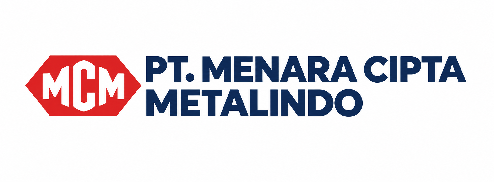

# Eksplorasi lanjutan logo no. 4

## Arah dari pengguna
- Klien memilih konsep no. 4 sebagai dasar.
- Pertahankan sederhana, mudah dibaca, dan punya alasan bentuk yang kuat.
- Hindari bentuk bulat; eksplorasi selanjutnya juga menghindari kotak/diamond sebagai wadah.
- Pertahankan kesinambungan: simbol MCM di kiri, nama perusahaan di kanan, keluarga merah–biru.

## 04d — Heksagon horizontal

Pengguna memilih kandidat kedua dari dua opsi visual. Pilihan ini menunjukkan preferensi eksplorasi, bukan persetujuan final klien atau master siap produksi.

### Elemen bentuk
- Wadah bersisi enam, memanjang horizontal, dengan sisi atas–bawah datar dan ujung miring.
- Inisial MCM putih, C lebih tinggi sebagai pusat visual.
- Nama perusahaan biru tua dalam dua baris di kanan.

### Makna yang diusulkan
- Sisi datar dan potongan miring: gagasan presisi potong serta pembentukan bidang logam.
- Bentuk kompak dan menyatu: gagasan kekokohan struktur.
- MCM tetap dominan: mempertahankan identitas nama perusahaan.

Makna tersebut adalah narasi desain usulan, bukan filosofi resmi perusahaan. Heksagon bukan bukti kemampuan teknis atau sertifikasi perusahaan.

### Sebelum finalisasi
- Rapikan menjadi vektor dengan warna solid yang konsisten; hasil generasi ini belum menjamin seluruh piksel bebas shading.
- Uji bobot C terhadap dua M serta ruang kosong internal pada ukuran kecil.
- Uji pemenggalan nama, jarak simbol–wordmark, dan ukuran pada seragam.
- Periksa versi satu warna, kemiripan merek, serta sampel bordir.

Berkas `04c-sambungan-kokoh.png` adalah eksplorasi sebelumnya yang terpilih di antarmuka pembanding, bukan arah heksagon terbaru. Dua arah sebelumnya (04a/04b) dilewati dan tidak memiliki gambar terpilih. Logo no. 4 dan seluruh aset di aplikasi belum diganti oleh eksplorasi ini.
